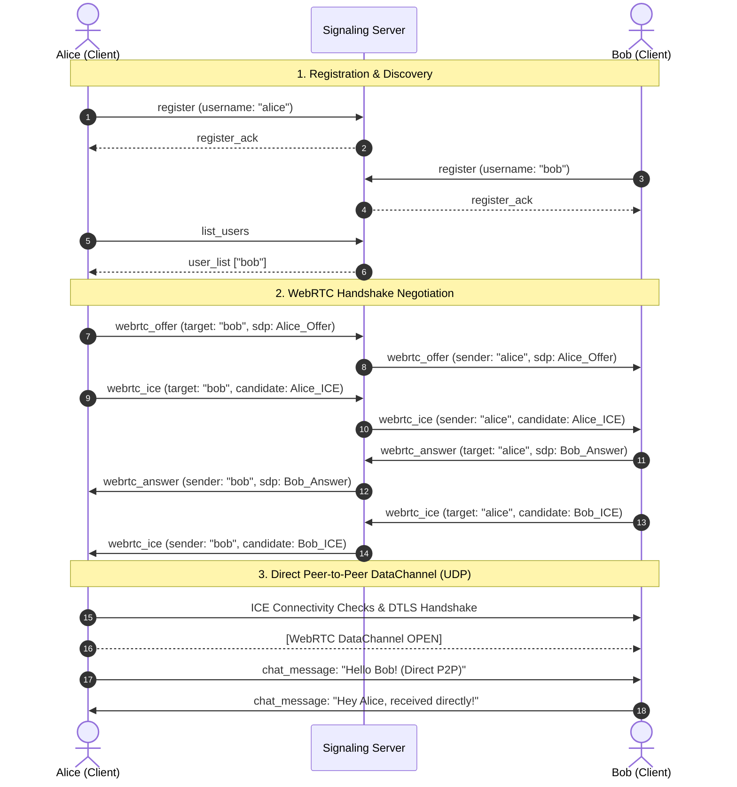

# cli-chat — Internet-Enabled Peer-to-Peer CLI Chat (WebRTC)

A terminal-based command-line peer-to-peer (P2P) chat application in Python that enables users across local networks and the internet to communicate directly using **WebRTC DataChannels** (`aiortc`), backed by a lightweight discovery and signaling server.

---

## 1. Project Overview

`cli-chat` provides real-time, terminal-based messaging directly between two peers. Rather than routing personal conversations through an intermediary chat server, `cli-chat` utilizes **WebRTC DataChannels** for end-to-end direct peer-to-peer transport over UDP, encrypted with **DTLS (Datagram Transport Layer Security)**.

A central **Signaling Server** coordinates peer registration and session negotiation (exchanging SDP offers, answers, and ICE candidates). Once the WebRTC peer connection is established, all chat messages flow directly between peers.

### Key Features
* **Direct Peer-to-Peer**: Chat messages travel exclusively between peers over WebRTC DataChannels.
* **Zero Message Relay**: The signaling server never receives, relays, stores, or inspects chat messages.
* **Internet-Enabled**: Configurable STUN server support (`stun:stun.l.google.com:19302`) discovers public reflexive IP addresses and ports to traverse NATs across separate internet connections.
* **No TURN Dependency**: Explicitly designed without third-party message relays or TURN proxies; clear diagnostics when network firewalls prohibit direct traversal.
* **Async & Thread-Safe CLI**: Background networking loop coupled with mutex-synchronized terminal display, ensuring incoming messages appear seamlessly without corrupting active typing.
* **Pure Python CLI**: Built with Python 3, `aiortc`, and standard library modules (`asyncio`, `socket`, `threading`, `json`, `struct`, `unittest`).

---

## 2. Architecture

```text
                           +-------------------------------------+
                           |           Signaling Server          |
                           |              (server.py)            |
                           |  - Online User Discovery            |
                           |  - WebRTC SDP Offer / Answer Relay  |
                           |  - Trickle ICE Candidate Routing    |
                           |  - STRICT: Zero Chat Messages       |
                           +-------------------------------------+
                                      /               \
                    1. Signaling TCP /                 \ 1. Signaling TCP
                       (Port 5000)  /                   \ (Port 5000)
                                   v                     v
                        +--------------------+   +--------------------+
                        |      Client A      |   |      Client B      |
                        |     (client.py)    |   |     (client.py)    |
                        +--------------------+   +--------------------+
                            |                                |
                            | 2. STUN Binding Request        | 2. STUN Binding Request
                            v (UDP 19302)                    v (UDP 19302)
                        +---------------------------------------------+
                        |                 STUN Server                 |
                        |          (stun.l.google.com:19302)          |
                        +---------------------------------------------+
                                      \                 /
                                       \               /
                                  ===========================
                                  3. Direct WebRTC DataChannel
                                     (Peer-to-Peer over UDP)
                                     DTLS Encrypted Messaging
                                  ===========================
```

### Component Responsibilities

1. **Signaling Server (`server.py`)**:
   - Manages an in-memory registry of online clients (`username`, IP, connection socket).
   - Validates signaling actions (`register`, `list_users`, `webrtc_offer`, `webrtc_answer`, `webrtc_ice`).
   - Stamps the authenticated sender on all forwarded signaling payloads to prevent username spoofing.
   - Strictly rejects any payload of type `chat_message` with a `403 Forbidden` error.

2. **WebRTC Client (`client.py`)**:
   - Maintains a signaling connection to the server using length-prefixed framing.
   - Manages `RTCPeerConnection` and `RTCDataChannel` lifecycles via `aiortc`.
   - Gathers host candidates and queries STUN servers for server-reflexive (`srflx`) candidates.
   - Sends and receives chat messages strictly via `channel.send()` and `channel.on("message")`.
   - Runs network coroutines on a dedicated `asyncio` event loop thread, keeping terminal input unblocked.

3. **Wire Protocol (`protocol.py`)**:
   - Provides 4-byte big-endian binary length framing for TCP signaling traffic.
   - Maximum signaling payload enforced at 64 KB (`MAX_MESSAGE_SIZE = 65536`).
   - Supports both synchronous socket and asynchronous `asyncio.StreamReader` / `asyncio.StreamWriter` framing.

4. **Configuration (`config.py`)**:
   - Zero-dependency `.env` parser that respects operating system environment variable overrides.
   - Validates IPv4 addresses, ports, and internet hostnames/domains.
   - Configures STUN server endpoints.

---

## 3. How Signaling and WebRTC Work

### Signaling Flow



### ICE and STUN Traversal
1. **Host Candidates**: Represent local private IP addresses on the machine's network interface (e.g., `192.168.1.5` or `10.0.0.2`).
2. **Server Reflexive (`srflx`) Candidates**: Discovered by sending UDP binding requests to a public STUN server (such as `stun.l.google.com:19302`). The STUN server inspects the source socket and returns the public IP address and mapped NAT port allocated by the router.
3. **Connectivity Checks**: Once candidates are exchanged via signaling, both peers send direct STUN check packets to each other's candidate addresses over UDP. When a bidirectional path succeeds, DTLS encryption is established and the DataChannel opens.

---

## 4. Network Limitations & No-Relay Policy

> [!IMPORTANT]
> **Zero Relay Policy**: This application does **not** deploy a TURN server or server-side message relay. Chat messages are never proxied through the signaling server under any circumstances.

### Why Direct Connectivity May Fail on Some Networks

Direct P2P traversal depends on the NAT filtering behavior of both endpoints:

| NAT Type Combination | Traversal with STUN | Outcome in cli-chat |
| :--- | :--- | :--- |
| **Full Cone + Any NAT** | Successful | Direct P2P Connected |
| **Address/Port Restricted Cone + Cone** | Successful | Direct P2P Connected |
| **Symmetric NAT + Cone NAT** | Often Successful | Direct P2P Connected |
| **Symmetric NAT + Symmetric NAT** | **Impossible without Relay** | Reports Direct Connection Failure |
| **Enterprise / Strict UDP Blocking** | **Impossible without Relay** | Reports Direct Connection Failure |

* **Symmetric NAT**: Some mobile carriers (CGNAT) and enterprise/campus firewalls allocate a different external port for every distinct destination IP/port. Because Peer A cannot predict the port Peer B's NAT will allocate for incoming packets, direct hole punching between two symmetric NATs fails.
* **UDP Firewalls**: If a corporate or public guest network blocks outbound UDP traffic on non-standard ports, WebRTC media/data packets cannot pass.

### Failure Handling & Diagnostics
When a direct connection cannot be established within the 10-second timeout or when ICE checks fail, `cli-chat` outputs a clear diagnostic:
```text
[-] Direct WebRTC connection to '<target>' timed out.
    Reason: Could not establish a direct peer-to-peer path within 10 seconds.
    Possible Causes:
    1. Restrictive firewalls or symmetric NATs blocking direct UDP traversal.
    2. Peer '<target>' did not respond or is unreachable.
    Note: By design, chat messages are NEVER relayed through the signaling server.
    Troubleshooting:
    - Verify both devices allow outbound UDP on standard ports.
    - If on restrictive corporate/guest Wi-Fi with client isolation, test using standard networks or mobile hotspots.
```
Resources are closed cleanly, and users can attempt a new connection without restarting the application.

---

## 5. Prerequisites & Installation

### Requirements
* **Python**: Python 3.9+ (tested on Python 3.13)
* **Operating Systems**: macOS, Linux, Windows 10/11

### Installation Steps

1. **Clone the repository**:
   ```bash
   git clone <repository_url>
   cd cli-chat
   ```

2. **Create and activate a virtual environment**:
   * **macOS / Linux**:
     ```bash
     python3 -m venv .venv
     source .venv/bin/activate
     ```
   * **Windows (PowerShell)**:
     ```powershell
     python -m venv .venv
     .\.venv\Scripts\Activate.ps1
     ```

3. **Install dependencies**:
   ```bash
   pip install -r requirements.txt
   ```

---

## 6. Configuration

Configuration is managed using environment variables or a local `.env` file.

Create your `.env` from the template:
```bash
# macOS / Linux
cp .env.example .env

# Windows PowerShell
Copy-Item .env.example .env
```

### Configuration Options

| Variable | Description | Default | Example |
| :--- | :--- | :--- | :--- |
| `SERVER_HOST` | Interface IP for the signaling server to bind | `0.0.0.0` | `0.0.0.0` |
| `SERVER_PORT` | TCP port for the signaling server | `5000` | `5000` |
| `SIGNALING_SERVER_IP` | Public IP, LAN IP, or domain of signaling server | `127.0.0.1` | `chat-signal.example.com` or `203.0.113.10` |
| `STUN_SERVER_URL` | STUN server URL for WebRTC NAT traversal | `stun:stun.l.google.com:19302` | `stun:stun.cloudflare.com:3478` |
| `CLIENT_USERNAME` | (Optional) Preset client username | `""` | `alice` |
| `LOG_LEVEL` | Logging verbosity (`DEBUG`, `INFO`, `WARNING`, `ERROR`)| `INFO` | `INFO` |
| `DEBUG_MODE` | Enable detailed WebRTC / ICE logging | `false` | `true` |

---

## 7. Cloud Signaling Server Deployment Guide

To allow clients on different internet networks to discover each other, deploy `server.py` to a publicly accessible cloud virtual machine (AWS EC2, Google Cloud Compute Engine, DigitalOcean Droplet, Linode, or Hetzner).

### Step 1: Provision Cloud VM & Install Dependencies
On an Ubuntu 22.04/24.04 server:
```bash
sudo apt update && sudo apt install -y python3 python3-venv git

git clone <your-repo-url> /opt/cli-chat
cd /opt/cli-chat

python3 -m venv .venv
./.venv/bin/pip install --upgrade pip
./.venv/bin/pip install -r requirements.txt
```

### Step 2: Configure Environment
```bash
cat << 'EOF' > /opt/cli-chat/.env
SERVER_HOST=0.0.0.0
SERVER_PORT=5000
LOG_LEVEL=INFO
DEBUG_MODE=false
EOF
```

### Step 3: Configure Cloud & OS Firewalls
1. **Cloud Provider Security Groups / Firewall Rules**:
   - Inbound Rule: Allow **TCP port 5000** from source `0.0.0.0/0` (Signaling).
2. **Operating System Firewall (UFW on Ubuntu)**:
   ```bash
   sudo ufw allow 22/tcp comment "SSH"
   sudo ufw allow 5000/tcp comment "cli-chat signaling"
   sudo ufw enable
   ```

### Step 4: Run as a Persistent Systemd Service
Create the service unit file:
```bash
sudo tee /etc/systemd/system/cli-chat-server.service << 'EOF'
[Unit]
Description=cli-chat Signaling Server
After=network.target

[Service]
Type=simple
User=ubuntu
WorkingDirectory=/opt/cli-chat
ExecStart=/opt/cli-chat/.venv/bin/python /opt/cli-chat/server.py
Restart=always
RestartSec=5
StandardOutput=journal
StandardError=journal

[Install]
WantedBy=multi-user.target
EOF
```

Reload systemd and start the service:
```bash
sudo systemctl daemon-reload
sudo systemctl enable --now cli-chat-server
sudo systemctl status cli-chat-server
```

### Step 5: Production TLS for Signaling Connections
For production environments exposed to the open internet, secure signaling traffic using TLS.

You can terminate TLS with Nginx and forward plaintext TCP traffic, or wrap the socket using standard Python `ssl`:

**Using Nginx Stream Module (SSL Termination)**:
```nginx
# /etc/nginx/nginx.conf
stream {
    upstream signaling_backend {
        server 127.0.0.1:5000;
    }

    server {
        listen 5443 ssl;
        proxy_pass signaling_backend;

        ssl_certificate /etc/letsencrypt/live/chat.yourdomain.com/fullchain.pem;
        ssl_certificate_key /etc/letsencrypt/live/chat.yourdomain.com/privkey.pem;
        ssl_protocols TLSv1.2 TLSv1.3;
    }
}
```

---

## 8. Running the Application

### Local Testing (Single Machine)

Open three terminal windows:

* **Terminal 1 (Signaling Server)**:
  ```bash
  python server.py
  ```

* **Terminal 2 (Client 1 - Alice)**:
  ```bash
  python client.py alice 127.0.0.1
  ```

* **Terminal 3 (Client 2 - Bob)**:
  ```bash
  python client.py bob 127.0.0.1
  ```

---

## 9. Interactive CLI Commands

Once inside `client.py`, the interactive prompt appears:

```text
=======================================================
       PYTHON P2P CLI CHAT (WebRTC DataChannel)
=======================================================
CLI > /help
```

| Command | Syntax | Description |
| :--- | :--- | :--- |
| `/users` | `/users` | Lists registered online peers from the signaling server. |
| `/chat` | `/chat <username>` | Negotiates a direct WebRTC DataChannel connection and sets the peer as active chat partner. |
| `/msg` | `/msg <username> <text>` | Sends a direct message to a peer over the WebRTC DataChannel (establishes connection if not already open). |
| Direct Chat | `<text>` | When an active chat partner is set (`CLI [username] >`), any text entered without a leading `/` is sent directly over WebRTC. |
| `/status` | `/status` | Displays signaling state, STUN server URL, and all active WebRTC peers with ICE and DataChannel states. |
| `/close` | `/close [username]` | Gracefully closes the direct WebRTC DataChannel and peer connection. |
| `/help` | `/help` | Displays available commands and usage instructions. |
| `/exit` | `/exit` | Closes all WebRTC channels, disconnects from signaling, and exits cleanly. |

---

## 10. Real-World Cross-Network Testing Procedure

To verify direct WebRTC communication across two separate internet networks:

```text
[Device A: Laptop on Home Wi-Fi]                     [Device B: Laptop on Mobile Hotspot]
  Public IP: 198.51.100.25                             Public IP: 203.0.113.88
             \                                                    /
              \                                                  /
               v                                                v
               +------------------------------------------------+
               |        Public Cloud Signaling Server           |
               |         (e.g., 54.210.12.34:5000)              |
               +------------------------------------------------+
                                       |
                                       v
                 [Direct WebRTC DataChannel Established]
                 (Peer-to-Peer UDP via STUN reflexive mapping)
```

### Step-by-Step Verification Procedure

1. **Prerequisites**:
   - Device A connected to Network 1 (e.g., Home Wi-Fi).
   - Device B connected to Network 2 (e.g., 4G/5G Mobile Hotspot).
   - Both devices have cloned the repository, set up `.venv`, and installed `requirements.txt`.
   - The signaling server is running on a public cloud server (e.g., `54.210.12.34:5000`).

2. **Configure Clients**:
   * On Device A:
     ```bash
     export SIGNALING_SERVER_IP="54.210.12.34"
     python client.py alice
     ```
   * On Device B:
     ```bash
     export SIGNALING_SERVER_IP="54.210.12.34"
     python client.py bob
     ```

3. **Discover Peers**:
   On Device A:
   ```text
   CLI > /users
   =============================================
                 ONLINE USERS
   =============================================
     • bob
   =============================================
   ```

4. **Initiate Direct WebRTC Chat**:
   On Device A:
   ```text
   CLI > /chat bob
   [*] Initiating direct WebRTC P2P connection to 'bob'...
   [*] Waiting for direct P2P connectivity checks with 'bob'...
   [+] Direct WebRTC DataChannel established with 'bob'! (Encrypted P2P)
   CLI [bob] >
   ```

5. **Exchange Direct Messages**:
   * From Device A:
     ```text
     CLI [bob] > Hello Bob across the internet!
     [21:45:00] [You -> bob]: Hello Bob across the internet!
     ```
   * On Device B, the message appears immediately:
     ```text
     [21:45:00] [alice]: Hello Bob across the internet!
     CLI [alice] > I received your message directly over WebRTC!
     ```

6. **Confirm Zero Server Relaying**:
   Inspect the signaling server console on the cloud VM. The server logs will show only:
   ```text
   Accepted signaling connection from 198.51.100.25:52310
   Registered user 'alice'
   Accepted signaling connection from 203.0.113.88:41822
   Registered user 'bob'
   Routed webrtc_offer from 'alice' to 'bob'
   Routed webrtc_answer from 'bob' to 'alice'
   Routed webrtc_ice from 'alice' to 'bob'
   Routed webrtc_ice from 'bob' to 'alice'
   ```
   **No chat text appears in server logs.** Chat payloads never transit the signaling server.

7. **Verify WebRTC Status**:
   ```text
   CLI [bob] > /status
   ==================================================
               CONNECTION STATUS
   ==================================================
     Username:            alice
     Signaling Server:    54.210.12.34:5000 (CONNECTED)
     STUN Server:         stun:stun.l.google.com:19302
     Active Chat Partner: bob
     Direct WebRTC Peers: 1
       - bob          (PC: connected, ICE: completed, Channel: open)
   ==================================================
   ```

---

## 11. Automated Test Suite

Run the automated test suite with Python's built-in `unittest` runner:

```bash
python test_chat.py -v
```

### Test Suite Coverage (30 Test Cases)

* **Configuration & Validation** (7 tests):
  - `test_validate_ip`: Strict IPv4 address validation.
  - `test_validate_host`: Validation of IPv4, IPv6, hostnames, and domain names.
  - `test_validate_port`: Port boundary validation (1024–65535).
  - `test_validate_stun_urls`: Validation and parsing of comma-separated STUN/STUNS URLs.
  - `test_parse_bool`: String boolean parsing.
  - `test_load_dotenv`: Custom zero-dependency `.env` loader with environment override precedence.
  - `test_lan_ip_detection`: Outbound interface discovery.
* **Protocol & Framing** (3 tests):
  - `test_send_and_recv_msg_roundtrip`: Synchronous length-prefixed binary framing.
  - `test_async_send_and_recv_msg_roundtrip`: Asynchronous StreamReader/StreamWriter binary framing.
  - `test_oversized_payload_rejection`: Payload limit boundary enforcement (`MAX_MESSAGE_SIZE = 64 KB`).
* **Signaling Server** (11 tests):
  - `test_registration_and_duplicate_rejection`: Username validation and collision prevention.
  - `test_re_registration_rejected`: Prevents socket-level username hijacking and duplicate registration.
  - `test_malformed_signaling_payloads`: Rejection of invalid SDP or malformed candidate payloads.
  - `test_online_user_discovery`: Online user registry filtering.
  - `test_webrtc_offer_and_answer_routing`: Signaling routing with authenticated sender stamping.
  - `test_webrtc_ice_candidate_routing`: Trickle ICE candidate routing.
  - `test_unregistered_client_signaling_rejected`: Blocks unauthorized signaling attempts.
  - `test_nonexistent_target_signaling_error`: Graceful error reporting for offline targets.
  - `test_self_signaling_rejected`: Prevents self-signaling loops.
  - `test_user_disconnection_broadcast`: Disconnection notice dissemination.
  - `test_strict_server_rejection_of_chat_messages`: **Critical security test** verifying chat messages sent to signaling server are rejected with `403 Forbidden`.
* **Direct WebRTC P2P DataChannel** (7 tests):
  - `test_direct_p2p_chat_session`: End-to-end WebRTC offer/answer, STUN gathering, and bidirectional messaging.
  - `test_multiple_peers_chat`: Concurrent DataChannel management across multiple distinct peers.
  - `test_duplicate_connection_attempt`: Idempotent handling of repeat `/chat` invocations.
  - `test_connection_timeout_handling`: Graceful timeout and resource cleanup when peer is non-responsive.
  - `test_immediate_failure_on_offline_peer`: Immediate failure without 10-second hang when target peer is offline.
  - `test_send_oversized_chat_message`: Rejection and error reporting for messages exceeding 64 KB.
  - `test_peer_cleanup_and_reconnection`: Clean teardown of WebRTC resources and successful reconnect.
* **Repository & Security Hygiene** (2 tests):
  - `test_env_example_exists`: Validates presence of `.env.example` with required keys including STUN.
  - `test_gitignore_rules`: Validates strict exclusion of local `.env` and Python virtualenvs.

---

## 12. Troubleshooting

| Issue | Likely Cause | Solution |
| :--- | :--- | :--- |
| `Could not connect to signaling server` | Signaling server is stopped, firewall is blocking TCP 5000, or incorrect IP configured. | Verify `server.py` is running (`systemctl status cli-chat-server`) and cloud firewall allows inbound TCP 5000. |
| `Direct WebRTC connection timed out` | Both peers are behind symmetric NATs or UDP traffic is blocked. | Test using standard Wi-Fi or mobile hotspots. Ensure UDP traffic is not filtered by local firewall software. |
| `Registration failed: Username already in use` | Another user is registered with that name. | Choose a unique username using alphanumeric characters. |
| `DataChannel is not open (state: connecting)` | DTLS handshake is still in progress. | Wait 1-2 seconds for ICE checks to complete before sending text. |
| `Warning: Invalid characters in Host` | Malformed hostname provided. | Ensure hostname contains only letters, numbers, dots, and hyphens. |
